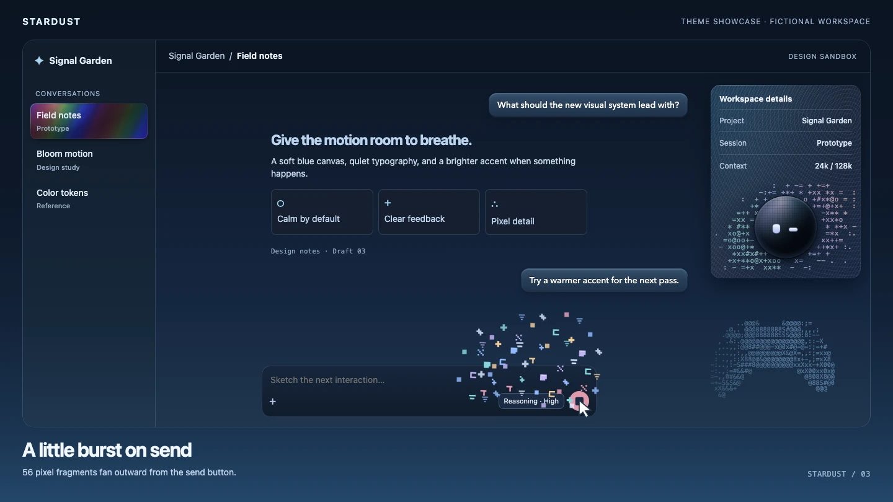

# Stardust for T3 Code

Stardust is a dark, single-file theme for T3 Code. A quiet blue canvas makes room for a few playful details.

[Download the theme](https://github.com/Ne1ther/stardust-t3/releases/latest/download/stardust.json) · [Watch the 4K launch film](https://github.com/Ne1ther/stardust-t3/releases/download/v1.0.0/stardust-launch-4k.mp4)

## The details

- **Send confetti.** Fifty-six pixel fragments fan out to the left from the send button in the main chat and side chat.
- **Animated ASCII controller.** The controller changes perspective in the free space beside a wide conversation. It settles between turns of the animation.
- **Reasoning ripple.** Hover or keyboard-focus a reasoning effort to see a two-pass pixel wave. This interaction is adapted from MonoCode.
- **Rainbow foil.** A narrow highlight sweeps across the selected conversation on hover or selection.
- **ASCII companion.** A small orb in the thread details panel changes expression with the activity visible in the chat.
- **Blue canvas.** One background gradient sits behind the conversation, with raised message bubbles and muted surfaces.

## Install

1. Download `stardust.json` from the [latest release](https://github.com/Ne1ther/stardust-t3/releases/latest).
2. Open **Settings → Appearance** in T3 Code and choose **Add a theme**.
3. Drop in `stardust.json`, then select **Stardust** as the dark theme.

The JSON was validated with the T3 Code Nightly theme loader. The controller needs a wide conversation layout, and the companion appears in the thread details panel. Reduced Motion disables the main visual animations. The theme embeds its artwork and needs no external asset requests.

The 4K launch film shows a conversation switch, the send burst, all six reasoning levels, the full ASCII controller turn, and the companion inside the thread details card. It uses the theme's artwork and CSS in a fictional workspace.

## Credits

The reasoning ripple adapts [MonoCode](https://github.com/hardbeat920/monocode) by Nick. Its MIT notice is included in [NOTICE-MonoCode.txt](NOTICE-MonoCode.txt) and in the theme CSS.

The blue direction was inspired by [Stargazer](https://github.com/wellbrained/t3code-stargazer) by wellbrained.
